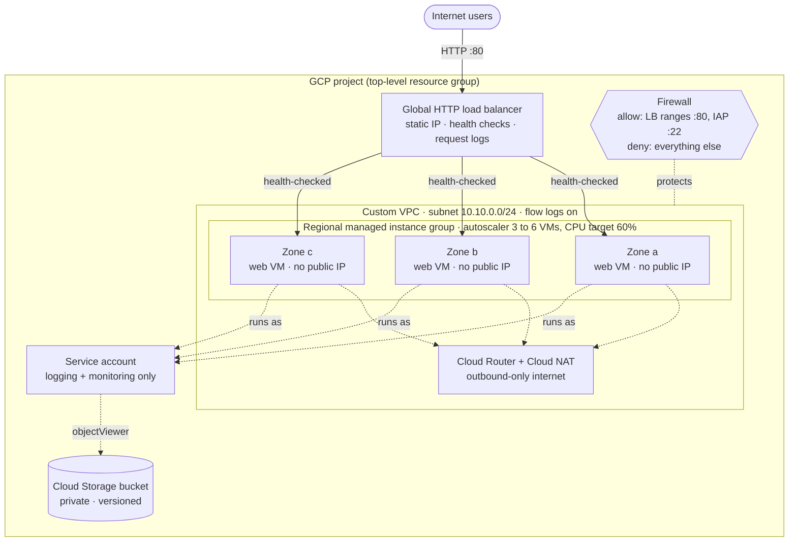

# Project 1 – Cloud Infrastructure Deployment (Google Cloud + Terraform)

A complete, reusable **Infrastructure as Code** project that deploys a secure, scalable and highly available web platform on **Google Cloud Platform (GCP)** using **Terraform**.

One command (`terraform apply`) creates the network, firewall rules, identity, storage, a multi-zone autoscaling group of web servers, and a global load balancer. One command (`terraform destroy`) removes everything.

---

## Table of contents

1. [What it deploys](#1-what-it-deploys)
2. [Architecture](#2-architecture)
3. [How it meets the project requirements](#3-how-it-meets-the-project-requirements)
4. [Project structure](#4-project-structure)
5. [Prerequisites](#5-prerequisites)
6. [Deployment guide](#6-deployment-guide)
7. [Configuration reference](#7-configuration-reference)
8. [Verifying the deployment](#8-verifying-the-deployment)
9. [Testing](#9-testing)
10. [Security design](#10-security-design)
11. [Estimated cost](#11-estimated-cost)
12. [Cleanup](#12-cleanup)
13. [Troubleshooting](#13-troubleshooting)
14. [Possible improvements](#14-possible-improvements)

---

## 1. What it deploys

27 GCP resources, grouped into five Terraform modules:

| Module | Resources | Purpose |
|---|---|---|
| **network** | Custom VPC, subnet (with flow logs), Cloud Router, Cloud NAT | Private network; VMs reach the internet outbound-only |
| **security** | Service account, 2 IAM role bindings, 4 firewall rules | Least-privilege identity and network access control |
| **storage** | Cloud Storage bucket + read-only IAM binding | Private, versioned storage for application assets |
| **compute** | Instance template, regional managed instance group (MIG), autoscaler, health check | Hardened Nginx web servers spread across zones |
| **loadbalancer** | Global static IP, backend service, URL map, HTTP proxy, forwarding rule | Single public entry point with health-based routing |

The root module also enables the required Google APIs (Compute, IAM, Logging, Monitoring, Storage).

## 2. Architecture



Request flow: a user hits the load balancer's static IP → the load balancer picks a **healthy** VM in any zone → Nginx answers with a page that shows which instance and zone served it. If a VM or an entire zone fails, the health check removes it from rotation and the MIG recreates it.

## 3. How it meets the project requirements

| Requirement | How this project delivers it |
|---|---|
| **Well-structured** – VMs, networking, storage and resource groups properly organized | Five single-purpose modules (`network`, `security`, `storage`, `compute`, `loadbalancer`). Consistent naming (`<prefix>-<env>-<resource>`). Everything lives in one GCP project and carries the same labels (`project`, `environment`, `managed-by`), so resources can be filtered and billed together. |
| **Scalable** – easy scaling on workload | Regional MIG + autoscaler scales **3 → 6** VMs on CPU (60% target). Change `min_replicas` / `max_replicas` / `machine_type` and re-apply. Instances come from a template, so scaling is automatic and identical. |
| **Secure** – identity, firewall rules, network security | Dedicated least-privilege service account (not the default Editor account). Firewall is default-deny; HTTP is allowed only from Google's load-balancer ranges, SSH only through Identity-Aware Proxy. VMs have **no public IP**, use Shielded VM, OS Login, and block project-wide SSH keys. The bucket enforces public access prevention. |
| **Highly available** – multiple zones or regions | The MIG distributes VMs across **three zones** (validated: at least two are required, and `min_replicas ≥ 2`). Health checks plus **auto-healing** replace failed VMs. Rolling updates keep capacity during changes. The global load balancer routes only to healthy backends. |
| **Well-documented** – architecture, configuration, setup | This README (architecture diagram, variable reference, step-by-step deployment, verification, troubleshooting), `terraform.tfvars.example`, a description on every variable/output, and comments in the code. |

## 4. Project structure

```
project-1-cloud-infrastructure-deployment/
├── README.md                      # this file
├── versions.tf                    # Terraform + provider version constraints
├── main.tf                        # provider, API enablement, module wiring
├── variables.tf                   # all inputs (with validation)
├── outputs.tf                     # load balancer IP/URL, names, security summary
├── terraform.tfvars.example       # copy to terraform.tfvars and edit
├── .terraform.lock.hcl            # pinned provider version (commit this)
├── .gitignore                     # keeps state, tfvars and credentials out of git
├── modules/
│   ├── network/                   # VPC, subnet, Cloud Router, Cloud NAT
│   ├── security/                  # service account, IAM roles, firewall rules
│   ├── storage/                   # private versioned bucket
│   ├── compute/                   # template, regional MIG, autoscaler, health check, startup.sh
│   └── loadbalancer/              # global IP, backend service, URL map, proxy, forwarding rule
└── tests/
    └── infrastructure.tftest.hcl  # offline tests (provider mocked, no GCP account needed)
```

## 5. Prerequisites

| Need | Notes |
|---|---|
| **Terraform ≥ 1.9** | [Install guide](https://developer.hashicorp.com/terraform/install). Check with `terraform version`. |
| **A GCP project with billing enabled** | Create one in the [console](https://console.cloud.google.com/projectcreate). New accounts get free credits. |
| **Google Cloud CLI (`gcloud`)** | [Install guide](https://cloud.google.com/sdk/docs/install). Used for authentication and for the verification steps. |
| **Permissions** | `Owner`, or `Editor` + `Project IAM Admin` + `Service Usage Admin`, on the project. |

## 6. Deployment guide

**1. Authenticate**

```bash
gcloud auth login
gcloud auth application-default login
gcloud config set project YOUR_PROJECT_ID
```

**2. Configure**

```bash
cd project-1-cloud-infrastructure-deployment
cp terraform.tfvars.example terraform.tfvars      # on Windows PowerShell: Copy-Item terraform.tfvars.example terraform.tfvars
```

Edit `terraform.tfvars` and set at least `project_id`.

**3. Initialize**

```bash
terraform init
```

**4. Preview the changes**

```bash
terraform plan
```

You should see **27 resources to add**.

**5. Deploy**

```bash
terraform apply
```

Type `yes` to confirm. Provisioning takes about 5–8 minutes.

**6. Get the URL**

```bash
terraform output application_url
```

Wait another 3–5 minutes after `apply` finishes: the VMs are still installing Nginx and the load balancer needs to see healthy backends. Until then you may see a `502` error – this is normal.

## 7. Configuration reference

All variables live in `variables.tf`. Only `project_id` is required.

| Variable | Default | Description |
|---|---|---|
| `project_id` | *(required)* | GCP project ID |
| `region` | `us-central1` | Region for regional resources |
| `zones` | `["us-central1-a","us-central1-b","us-central1-c"]` | Zones for the web tier (min. 2, must be unique) |
| `environment` | `dev` | `dev`, `staging` or `prod` – used in names and labels |
| `name_prefix` | `cloudinfra` | Prefix for every resource name (3–15 chars, lowercase) |
| `subnet_cidr` | `10.10.0.0/24` | CIDR of the application subnet |
| `machine_type` | `e2-small` | VM size |
| `boot_disk_size_gb` | `20` | Boot disk size |
| `min_replicas` | `3` | Autoscaler minimum (must be ≥ 2) |
| `max_replicas` | `6` | Autoscaler maximum (must be ≥ `min_replicas`) |
| `cpu_target_utilization` | `0.6` | CPU level (0–1) that triggers scale-out |
| `enable_iap_ssh` | `true` | Allow SSH through Identity-Aware Proxy |
| `bucket_force_destroy` | `true` | Let `destroy` delete a non-empty bucket |
| `extra_labels` | `{}` | Extra labels for all resources |

> If you change `region`, change `zones` to match (e.g. `europe-west1` → `["europe-west1-b","europe-west1-c","europe-west1-d"]`).

**Outputs:** `load_balancer_ip`, `application_url`, `network_name`, `subnet_cidr`, `instance_group_manager`, `zones`, `autoscaling_range`, `service_account_email`, `assets_bucket`, `security_posture`.

## 8. Verifying the deployment

**a) Open the site** – visit `terraform output -raw application_url`. Refresh several times: the *Zone* and *instance* values change as the load balancer spreads requests.

**b) Show high availability from the command line**

```bash
LB=$(terraform output -raw load_balancer_ip)
for i in $(seq 1 12); do curl -s http://$LB | grep -E "Zone"; done
```

You should see more than one zone in the output.

**c) Check instances and their zones**

```bash
gcloud compute instances list --filter="name~cloudinfra" --format="table(name,zone.basename(),status,networkInterfaces[0].accessConfigs[0].natIP)"
```

The last column (external IP) must be **empty** – the VMs are private.

**d) Test auto-healing** – delete one instance and watch the MIG recreate it while the site stays up:

```bash
gcloud compute instances delete INSTANCE_NAME --zone=ZONE
gcloud compute instance-groups managed list-instances cloudinfra-dev-web-mig --region=us-central1
```

**e) Test autoscaling** – SSH in through IAP and generate CPU load:

```bash
gcloud compute ssh INSTANCE_NAME --zone=ZONE --tunnel-through-iap
# then, on the VM:
yes > /dev/null & yes > /dev/null &
```

After a few minutes the MIG should grow beyond `min_replicas` (up to `max_replicas`).

## 9. Testing

The project ships with an automated test suite that runs **without a GCP account** by mocking the Google provider.

```bash
terraform init -backend=false
terraform fmt -check -recursive      # formatting
terraform validate                   # syntax and references
terraform test                       # 7 offline tests
```

What the tests check:

| Test | Asserts |
|---|---|
| `default_plan_is_highly_available` | 3 zones, autoscaler minimum ≥ 2, room to scale out |
| `default_plan_is_secure` | No VM public IPs, Shielded VM on, no firewall allow rule open to `0.0.0.0/0`, bucket blocks public access, uses uniform access and versioning |
| `iap_ssh_can_be_disabled` | Turning off `enable_iap_ssh` removes the SSH rule |
| `rejects_single_zone` | A one-zone deployment is refused |
| `rejects_single_replica` | `min_replicas = 1` is refused |
| `rejects_max_below_min` | `max_replicas < min_replicas` is refused |
| `rejects_bad_environment` | Unknown environment names are refused |

**Verified results:** `terraform fmt -check` clean, `terraform validate` successful, `terraform test` → **7 passed, 0 failed** (Terraform 1.17.1, `hashicorp/google` 6.50.0). I also confirmed the tests are meaningful by temporarily giving the VMs a public IP – the security test failed as expected, then I reverted the change.

> These are plan-time tests against a mocked provider. They prove the configuration is valid and enforces the design. A real `terraform apply` needs your own GCP project and credentials (see section 6).

## 10. Security design

| Control | Implementation |
|---|---|
| **Identity** | Dedicated service account with only `logging.logWriter`, `monitoring.metricWriter` and read-only access to the one bucket. The default Compute service account is **not** used. |
| **No public VMs** | The instance template has no external IP. Outbound traffic goes through Cloud NAT. |
| **Firewall** | Ingress is default-deny (explicit logged deny rule at priority 65000). Allowed: TCP 80 from Google LB/health-check ranges (`130.211.0.0/22`, `35.191.0.0/16`); TCP 22 only from IAP (`35.235.240.0/20`); intra-subnet traffic. Rules target the service account, not loose network tags. |
| **Remote access** | SSH only through IAP (`gcloud compute ssh --tunnel-through-iap`), with OS Login on and project-wide SSH keys blocked. |
| **VM hardening** | Shielded VM: Secure Boot, vTPM, integrity monitoring. |
| **Storage** | Uniform bucket-level access, public access prevention enforced, versioning, 30-day cleanup of old versions. |
| **Audit & visibility** | VPC flow logs, firewall rule logs, load balancer request logs, Cloud NAT error logs. |
| **Secrets** | `.gitignore` excludes `*.tfvars`, state files and key files. No credentials are stored in the code. |

## 11. Estimated cost

Rough figures for `us-central1`, always on (check the [pricing calculator](https://cloud.google.com/products/calculator) for exact numbers):

| Item | ≈ per month |
|---|---|
| 3 × `e2-small` VMs | $40 |
| Cloud NAT + load balancer forwarding rule | $25–35 |
| Disks, bucket, logs | < $10 |
| **Total (idle, 3 VMs)** | **≈ $75–85** |

Run `terraform destroy` as soon as you finish testing – a short demo costs only a few cents to a couple of dollars.

## 12. Cleanup

```bash
terraform destroy
```

Type `yes`. This removes all 27 resources (the enabled APIs are left on by design). Confirm in the console that no resources remain to avoid charges.

## 13. Troubleshooting

| Symptom | Cause / fix |
|---|---|
| `Error 403: ... API has not been used` right after apply starts | The API was just enabled and needs a minute to propagate. Re-run `terraform apply`. |
| `502 Bad Gateway` from the load balancer | Instances are still booting or failing the health check. Wait 3–5 min; check `gcloud compute backend-services get-health cloudinfra-dev-backend --global`. |
| `Quota ... exceeded` (CPUs, addresses) | Lower `max_replicas`/`min_replicas`, pick a smaller `machine_type`, or request a quota increase. |
| `bucket name already exists` | Bucket names are global. Change `name_prefix` or `environment`. |
| `Error: Invalid value for variable` | A validation rule triggered – read the message; e.g. at least two zones and `min_replicas ≥ 2` are enforced on purpose. |
| `Zone ... does not exist in region ...` | `zones` do not match `region`. Update both together. |
| IAP SSH fails | Your user needs the *IAP-secured Tunnel User* role, and `enable_iap_ssh` must be `true`. |

## 14. Possible improvements

- HTTPS with a Google-managed certificate and HTTP→HTTPS redirect (needs a domain name).
- Cloud Armor policy on the load balancer for WAF / rate limiting.
- Remote Terraform state in a Cloud Storage bucket with locking, for team use.
- Multi-region deployment with a global load balancer fronting two regional MIGs.
- Cloud Monitoring uptime check and alert policies.
- Cloud SQL (private IP) as a database tier.
